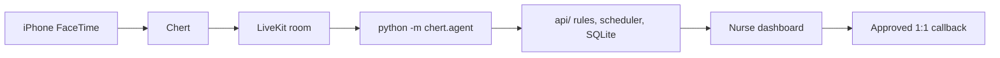

Execution: [docs/ROADMAP.md](docs/ROADMAP.md) (hour by hour, CT) and [agents/START.md](agents/START.md) (how to launch the Codex lanes).

# Homeward

**A FaceTime check-in that looks, listens and asks, then waits for a nurse.**

Homeward is a hackathon prototype. It is not a medical device, gives no diagnosis or treatment advice, uses only mock patient data, and every escalation is approved by a human care team.

Homeward calls a mock patient on FaceTime in the first days after a hospital stay. The demo patient is Rosa on day 3. The call looks at a pill organizer, listens through a short symptom check, and can run a breathing wellness check on the video. Deterministic rules mark the result GREEN, YELLOW, or RED. A named nurse approves every escalation. Heart rate in the demo is a labeled mock replay unless a watch workout is actually streaming.

## Architecture

Two paths share one API.

The judge path is Chert into LiveKit. [Chert](https://trychert.com/uta) bridges FaceTime into a LiveKit room. Chert has no tool calling, no transfer, and no avatar of its own. The agent is `python -m chert.agent`. Tools live in that agent because Chert has none. Only one participant publishes audio. `CHERT_FACE` defaults off.

The spare-Mac path is the fallback. The patient's iPhone FaceTimes a spare Mac. That Mac runs FaceTime, Preston's `facetime-bridge/bridge.mjs` (BlackHole audio to OpenAI Realtime), the call agent, vision, the API, the scheduler, and the nurse dashboard. The watch posts heart rate to the API. Nothing is escalated until a named nurse approves it.

```text
iPhone FaceTime  <-->  FaceTime on the spare Mac
                         | speaker / mic via BlackHole
                         v
                    bridge.mjs  <-->  OpenAI Realtime
                         |
                         v
                    agent/  -->  api/ (rules, scheduler, SQLite)
                         ^         ^
              mac/ frames + vision/   watch POST /v1/watch/hr
                                   dashboard/ approves --> scheduler dials
```



The callback is a separate call after a named nurse approves. It does not add a person to the check-in that is already up.

## Phase 2

The Chert agent is `python -m chert.agent`. Tools live in that agent because Chert has none. `CHERT_FACE` defaults off. `make vision-test` is the live vision check and is not part of `make test`.

Pill-read accuracy on real photos is not yet measured.

- Plan: [docs/PHASE2.md](docs/PHASE2.md)
- Judge script: [demo/DEMO_SCRIPT.md](demo/DEMO_SCRIPT.md)
- Devpost draft: [docs/DEVPOST.md](docs/DEVPOST.md)

## Run

Needs Python 3.12, [uv](https://docs.astral.sh/uv/), and Node 20+.

```bash
uv sync
cp .env.example .env
MAC_DRY_RUN=1 VISION_FAKE=fixtures make test
make e2e
make demo-check
make vision-test
make dev
```

`make e2e` is the simulated Rosa day-3 call. It uses mock data and does not dial.

`make demo-check` runs the preflight in `demo/check.sh`. It does not print a phone number or a tunnel host.

`make vision-test` is the live vision check and is not part of `make test`. CI does not run it. If it prints `vision key: MISSING`, the demo uses the photo fallback and does not place a second call. `VISION_FAKE=fixtures make vision-test` is a labeled fallback, not a live score.

`make dev` serves `GET /v1/health` at `http://127.0.0.1:8000/v1/health`. `MAC_DRY_RUN=1` prints Mac commands instead of running them. `VISION_FAKE=fixtures` uses canned vision reads. Real keys stay in `.env` on the spare Mac and are never committed.

`facetime-bridge/` is Preston's. Do not edit it from a lane PR.

## Safety

This is a prototype, not a medical device. Mock data only. A nurse approves every escalation. Breathing is a wellness check. The rules set the tier, and the model cannot lower it.

## Board

Agents coordinate on pinned issue [#1](https://github.com/prest626/hackuta/issues/1) via `tools/board`. Rules: `AGENTS.md`. Product spec: `docs/PRD.md`. Shared schemas and API: `docs/CONTRACTS.md`.

Cursor cloud agents cannot comment on #1 (the agent token returns 403). They append that same post to `CONVERSATIONS.MD`. Read that file for their notes.
