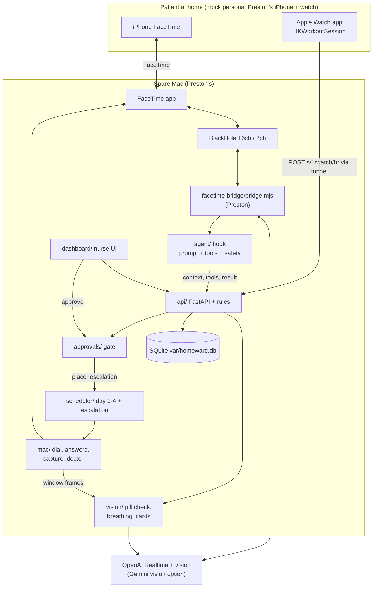
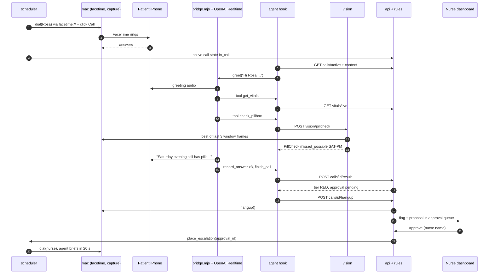
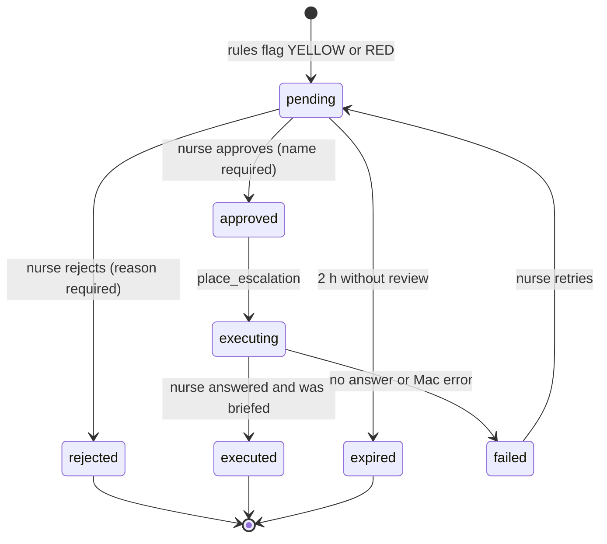
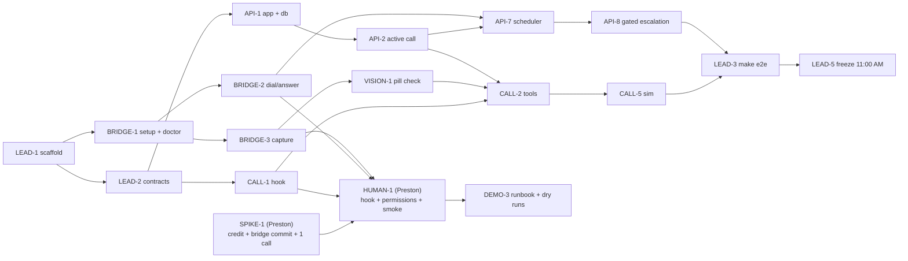

# Document control

| Field | Value |
|---|---|
| Product | **Homeward.** The hospital's care agent FaceTimes each discharged patient on **days 1, 2, 3 and 4**. On every call it checks the **pill organizer on camera** against the med schedule, asks **structured symptom questions**, runs an optional **breathing wellness check**, and reads the patient's **live Apple Watch heart rate**. Results land on a **care-team dashboard** with risk flags, and **a nurse approves every escalation** (a nurse callback; group FaceTime is a stretch) before anyone is contacted. |
| Event | HackUTA 2026, UT Arlington. Hacking **12:00 PM Sat Nov 14 → 12:00 PM Sun Nov 15 (CT)**. Devpost deadline listed as **11:59 PM Sat** [UNVERIFIED whether edits are allowed until noon]. Expo judging **1:00–3:00 PM Sun**, 3–4 minute pitch ([hackuta.com](https://www.hackuta.com/)). **Code freeze 11:00 AM Sun.** |
| Primary track | Chert × HackUTA **Best Use of FaceTime**: fresh use of FaceTime video **2×**, wow factor 1×, usefulness 1×; judged live by Gary Gao on a real FaceTime call; top 3 get interviews for Chert's FDE and SWE intern roles ([trychert.com/uta](https://trychert.com/uta)). Whether the prize requires building on Chert's platform is **[UNVERIFIED — ask Gary]** (Appendix A). |
| Builders | **Preston (@prest626) is the only human.** Every lane is a Cursor cloud agent (`[Preston's <lane>-agent]`) on `prest626/hackuta`, coordinated by **`[Preston's watson]`, the project manager**, through GitHub issues and the pinned board (issue #1). 8 lanes, 54 issues (8 epics + 46 work items, 4 of them `human:preston`). |
| What changed in v2 | **Chert and LiveKit are dropped**: Chert's hosted Mac kept going offline during setup (`line_offline`, `worker_unavailable`, `demo_attempt_conflict`). The patient's iPhone now FaceTimes **a spare Mac Preston owns**; Preston's `bridge.mjs` pipes FaceTime audio to OpenAI Realtime through BlackHole. Chert is parked as a fallback (`~/chert-agent`). |
| Companion files | `ROLES.md`, `CONTRACTS.md` + `contracts/` (JSON Schemas, `schema.sql`, examples), `COORDINATION.md`, `CODING_STYLE.md` (ponytail), `issues/` + `issues.json` + `issue_map.json`, `repo_bundle/`, `gen/` generators |
| Sources | Built on the earlier Discharge Companion PRD and Watson's stack notes (Sat 12:31 PM), plus Preston's board post with the spare-Mac plan (#1, Sat evening). Claims link to their sources inline; §13 lists them. **[ESTIMATE]**, **[PLACEHOLDER]** and **[UNVERIFIED]** mark anything not confirmed. |
| **Hard constraint** | **Homeward is a hackathon prototype. It is not a medical device. It gives no diagnosis and no treatment or dosing advice. It uses mock patient data only. A human care team approves every escalation.** See §11. |

**How to read this.** One page: §1. Why it wins and how it differs: §2–§3. Engineers and lane agents: §5–§7 plus CONTRACTS.md, then your lane card in ROLES.md and your issues. Preston: the facts box below, §9 (your four batches) and Appendix A. Pitch: §2, §3, §10, §11.

> **Spare-Mac facts every lane must design around** (from Preston's board post; the bridge is untested end to end)
>
> 1. **The FaceTime endpoint is a real Mac** signed in to the Apple ID patients call. Patients dial it (inbound) or it dials them (outbound, day 1–4).
> 2. **Audio path:** FaceTime speaker → **BlackHole 16ch** (system output) → `facetime-bridge/bridge.mjs` (Node, ~70 lines, Preston's) → **OpenAI Realtime** (`gpt-realtime`) → **BlackHole 2ch** → FaceTime microphone. Setup: `brew install sox blackhole-2ch blackhole-16ch node`, restart, `npm install`, `OPENAI_API_KEY` in `facetime-bridge/.env.local` (never committed), FaceTime mic = BlackHole 2ch, system output = BlackHole 16ch, `npm start`, wait for "Ready".
> 3. **Today a human clicks Accept and presses Enter** to start the greeting. We automate both: `mac.answerd` clicks Accept through System Events, and the agent hook greets when the call is live (§5.1).
> 4. **The agent has no eyes yet.** We screen-capture the FaceTime window at 1–2 fps (`screencapture -R` on the window bounds), run vision on the best frame, and hand the result to the Realtime session as a **tool result** (§5.3).
> 5. **The agent has no video yet.** Annotated cards go back through an **OBS virtual camera** set as FaceTime's camera (p2). Until then the cards show on the dashboard.
> 6. **Outbound is ours:** `open facetime://<number>` (or `facetime-audio://`) plus a System Events click on **Call**.
> 7. **One call at a time** (one FaceTime on one Mac). The spare Mac's speakers are silent while routed to BlackHole.
> 8. **Blocker:** the OpenAI account had **no credit** (`credit_balance_exhausted`). Realtime and vision both need it; SPIKE-1 starts with the top-up.
> 9. **`facetime-bridge/bridge.mjs` is Preston's.** It is in PR #3 (closes #2), not merged until a test call works. Any change under `facetime-bridge/` needs @prest626's OK on #1.
> 10. **Cloud agents can't touch the Mac.** Every Mac action is a thin wrapper with `MAC_DRY_RUN=1`; Preston verifies each once (HUMAN-1).

---

# 1. Executive summary

**One-line pitch:** *Homeward is the hospital calling you. For the first four days after you go home, it FaceTimes you, looks at your pill box, asks how you're breathing, reads your Apple Watch, and puts a nurse in charge of what happens next.*

**What it is.** A proactive post-discharge program run by an AI agent on a real FaceTime line (our own spare Mac running FaceTime, bridged to OpenAI Realtime), plus a small watchOS app and a care-team dashboard.

1. **Proactive schedule.** At discharge the care team enrolls the patient. Homeward calls on **day 1, 2, 3 and 4** at the time the patient chose (default 10:00 AM local). The patient installs nothing: the call is a normal FaceTime from a saved contact. Patients can also FaceTime Homeward any time; it auto-answers.
2. **Pill check on camera.** "Hold up your pill organizer." The agent grabs the sharpest frame of the FaceTime window, checks every compartment whose dose time has passed against the **med schedule**, and tells the patient what it saw: "Saturday evening still has pills." The annotated picture of the patient's own box goes to the dashboard (and back on FaceTime through OBS, stretch). It asks, never advises ("Did you take those from somewhere else?").
3. **Structured symptom questions.** 3–5 questions from the patient's discharge plan (heart failure example: breathlessness, ankle swelling, weight gain, overall better/same/worse). Red-flag answers get one confirmation question. Verbatim quotes are stored.
4. **Optional breathing check (wellness only).** A 20-second capture burst at ~5 fps estimates breathing rate from upper-body motion and abstains when the signal is poor; otherwise the patient counts breaths for 30 seconds.
5. **Apple Watch vitals.** A watchOS workout session streams **live heart rate** to our backend every few seconds; Health Auto Export (or mock history) supplies **resting HR, HRV, sleep respiratory rate and steps** for a personal baseline. The agent mentions one number in plain words.
6. **Care-team dashboard + approval gate.** Deterministic rules turn each call into GREEN / YELLOW / RED flags. YELLOW/RED creates an **escalation proposal** (a nurse callback). **Nothing happens until a named nurse clicks Approve.** Then Homeward FaceTimes the nurse from the same Mac and briefs them in 20 seconds.

**Why it matters (cited).**

- About **1 in 5** Medicare fee-for-service patients (19.6%) were rehospitalized within 30 days ([Jencks et al., NEJM 2009](https://www.nejm.org/doi/full/10.1056/NEJMsa0803563)); for heart failure the all-payer rate was **22.3%** in 2020 ([AHRQ HCUP SB #307](https://hcup-us.ahrq.gov/reports/statbriefs/sb307-readmissions-2020.jsp)).
- **80% of hospitals (2,334)** are penalized under Medicare's Hospital Readmissions Reduction Program for FY2027, with penalties up to 3% ([Healthcare Dive, Oct 8 2026](https://www.healthcaredive.com/news/hospital-readmission-reduction-program-penalties-rise-2027-cms/832473/)).
- **19%** of discharged patients had an adverse event after discharge, and **66%** of those were adverse drug events ([Forster et al., Ann Intern Med 2003](https://www.acpjournals.org/doi/10.7326/0003-4819-138-3-200302040-00007)).
- About **50%** of chronic-disease medications aren't taken as prescribed ([Viswanathan et al., Ann Intern Med 2012](https://www.acpjournals.org/doi/10.7326/0003-4819-157-11-201212040-00538)).

**What is honest about it.** AI post-discharge calls exist (Hippocratic AI, voice-only), and **Onset (Emory Hacks 2026) already built a FaceTime health check-in on Chert**, which is why Preston first dropped this idea. Homeward's defensible difference (§3) is the combination: a **proactive day 1–4 outbound schedule**, a **pill-box vision check against the med schedule**, **live Apple Watch vitals on the call**, and a **nurse approval gate** that keeps a human in charge of every escalation. It also runs on **our own FaceTime bridge**, so it doesn't depend on a hosted line being up.

---

# 2. First-principles analysis: what judges reward and how we win

## 2.1 Chert rubric (decides the primary prize)

| Criterion (weight) | Chert's words ([trychert.com/uta](https://trychert.com/uta)) | What we show |
|---|---|---|
| **Fresh use of FaceTime video (2×)** | "It uses what it sees in a way we haven't seen" | The agent **needs** the camera: it reads the patient's own pill box against their med schedule, compartment by compartment, and says exactly which one is off. Stretch: the annotated box comes back as the agent's FaceTime video (OBS) |
| Wow factor (1×) | "People stop and say 'wait, how did you do that?'" | **Homeward calls the judge** (outbound, unprompted). The live watch HR is read out on the call. After the call, a nurse clicks Approve and **the nurse's phone rings** with a 20-second brief |
| Usefulness (1×) | "It solves a real problem people want solved" | Readmissions and post-discharge medication errors (§1). A buyer with a budget line (HRRP penalties) and a workflow nurses recognize (transitions-of-care calls) |

**Implication:** every beat must show the camera or the call doing something a voice bot can't.

## 2.2 Why proactive + approval gate is the right shape (first principles)

1. **The risk window is the first days home.** A program that waits for the patient to call misses the people who most need it. So the agent **calls out** on a fixed day 1–4 schedule.
2. **Medication is the most common harm** (§1) and the most visible thing in the home. A pill organizer is a physical record of adherence the camera can read without identifying pills.
3. **Patients under-report; watches don't.** A live HR and a 7-day resting-HR trend add an objective signal to self-report.
4. **AI should triage, humans should act.** The rules are deterministic, the LLM can't lower a tier, and a nurse approves every outbound escalation. This answers the safety question before a judge asks it and matches how transitions-of-care teams already work.
5. **FaceTime removes setup.** Older patients already answer FaceTime. Group FaceTime is the handoff.

## 2.3 How it loses (and the counter)

| Loss mode | Counter |
|---|---|
| The bridge never completes a call (untested end to end) | SPIKE-1 first; Preston proves one inbound call before agents build on it; Chert parked as fallback (§10.4) |
| OpenAI credit not topped up | First line of SPIKE-1; vision can switch to Gemini (`VISION_PROVIDER=gemini`); recorded fallback video |
| Accept/Call clicks break (UI scripting is fragile) | Labels in one dict; `mac.doctor`; manual click is the live fallback |
| "Onset did this" | Name Onset first and show the differences (§3.2) |
| Medical overclaiming | "Check-in, not diagnosis"; nurse gate; no BP claims; wellness phrasing (§11) |
| "Does it count without Chert?" | Ask Gary in the first hour (Appendix A); the spare Mac is still a real FaceTime call; Chert fallback ready |
| Venue Wi-Fi | Phone hotspot for the spare Mac; recorded fallback video |

## 2.4 First hour: SPIKE-1 (Preston, ~45 min, blocks everything that touches the Mac)

1. Top up OpenAI credit; `curl https://api.openai.com/v1/models` with the key returns 200.
2. Merge PR #3 (`facetime-bridge/`, closes #2) once the call below works; `.env.local` stays gitignored.
3. One **inbound** FaceTime end to end: iPhone → spare Mac → Accept → the agent greets and answers.
4. One frame of the FaceTime window: `screencapture -x -R<x>,<y>,<w>,<h> /tmp/ft.jpg` shows the caller (note the self-preview position for VISION-2).
5. Watch: the HR sink receives a POST (or note "watch tomorrow" and use replay).
6. Ask Gary whether the prize requires Chert's platform.

Post results on #1 tagging watson. Lanes start on everything else with `MAC_DRY_RUN=1` in parallel.

---

# 3. Prior art and differentiation

## 3.1 What exists

| Product / project | What it does | How Homeward differs |
|---|---|---|
| **Onset** (Emory Hacks 2026) ([Devpost](https://devpost.com/software/onset)) | **Chert + LiveKit (Python) + MediaPipe.** ~60-s FaceTime check-in for stroke survivors: smile asymmetry, arm drift, speech; compares to a baseline; adds the caregiver and urges 911 on change; iMessages a summary | **The reason this idea was dropped once.** Onset is patient- or caregiver-initiated stroke screening of the face and arm. It has no med schedule, no pill check, no watch, no proactive multi-day schedule, and escalates automatically rather than through a nurse |
| **Remi** (HackPSU Fall 2026, Grand Prize) ([Devpost](https://devpost.com/software/remi-t70jd4)) | Chert elder FaceTime/iMessage companion with memory and red-flag triage | Companion-first; little camera perception; no care-team workflow |
| **Hippocratic AI** ([post-discharge check-in](https://hippocraticai.com/healthcare-agents/post-discharge-home-check-in/); [UHS](https://uhs.com/news/universal-health-services-launches-hippocratic-ais-generative-ai-healthcare-agents-to-assist-with-post-discharge-patient-engagement/)) | Voice agents that phone patients after discharge about symptoms and adherence, escalating to nurses | The incumbent workflow, **voice-only**: it can't see the pill box or show anything back |
| **Health Recovery Solutions** ([PatientConnect](https://www.healthrecoverysolutions.com/solutions/patientconnect-remote-patient-monitoring)) | Cellular tablet for symptoms, weight, adherence, vitals, human video visits | Dedicated hardware and human visits; Homeward uses the patient's own iPhone and watch with an AI caller |
| **AiCure** ([Labovitz et al., Stroke 2017](https://pmc.ncbi.nlm.nih.gov/articles/PMC5432369/)) | Smartphone app that visually confirms medication ingestion in trials | Dedicated app per dose; Homeward reads the organizer inside a call and never identifies pills |
| **Aftercare**, **CareLink**, **Kintsugi**, **Post-Discharge Check** (Devpost: [Aftercare](https://devpost.com/software/aftercare-htw587), [CareLink](https://devpost.com/software/carelink-k1pzeh), [Kintsugi](https://devpost.com/software/kintsugi-zh8jnk), [PDC](https://devpost.com/software/post-discharge-check-pdc)) | Scheduled post-discharge **voice** calls (Aftercare uses days 1, 3, 7), nurse dashboards | Voice only. Our schedule is similar; our camera and watch are not |
| **ELSA** ([Devpost](https://devpost.com/software/elsa-8k7pod)) | Apple Watch HealthKit alerts to caregivers | Watch-only; no call, no camera |
| **Dose Guard**, **PillBug** ([Dose Guard](https://devpost.com/software/dose-guard-fd8xk0), [PillBug](https://devpost.com/software/pillbug-nfxm54)) | Pillbox checks with dedicated camera/load-cell hardware | Homeward needs no hardware; the patient holds up the box they own |

## 3.2 Differentiation (say this in the pitch)

| | Onset (Chert, stroke) | Voice post-discharge agents | **Homeward** |
|---|---|---|---|
| Who starts the call | Patient/caregiver | Agent (voice) | **Agent, proactive, days 1–4** on a schedule the care team sets; patients can also call in |
| What the camera does | Face/arm screening | Nothing | **Pill organizer vs the med schedule**, compartment by compartment, with an annotated proof frame for the nurse |
| Objective vitals | None | None | **Live Apple Watch HR** on the call + resting-HR/HRV trend vs personal baseline |
| Who decides escalation | Automatic | Varies | **Nurse approval gate**: deterministic flags → proposal → a named nurse approves → callback |
| Platform | Chert hosted Mac + LiveKit | Telephony | **Our own FaceTime bridge** (spare Mac + BlackHole + OpenAI Realtime): no hosted line to go offline |
| Where the team works | iMessage summary | Vendor dashboard | **Care-team dashboard**: day 1–4 strip, proof frames, quotes, vitals, approval queue |

**Honest verdict.** Every single ingredient exists somewhere. We found no project or product that combines a proactive multi-day FaceTime schedule, a pill-organizer check against the med schedule, live watch vitals on the call, and a nurse-approved escalation. That absence is from our searches only.

---

# 4. SWOT

| | Helpful | Harmful |
|---|---|---|
| **Internal** | **Strengths:** the camera is necessary, not decorative (pill check against the schedule); proactive calls make the wow moment ("it called me"); deterministic rules + nurse gate answer the safety question; no patient app; we own the whole FaceTime path, so no hosted-line outages or minute caps | **Weaknesses:** the bridge is untested end to end; Accept/Call automation is UI scripting; agent video back needs OBS (stretch); one human for all physical tasks; pill check is a VLM read, not a validated detector; watch install friction (free signing, Developer Mode) |
| **External** | **Opportunities:** HRRP penalties hit 80% of hospitals ([Healthcare Dive](https://www.healthcaredive.com/news/hospital-readmission-reduction-program-penalties-rise-2027-cms/832473/)); Apple Watch Series 12 samples HR as often as every 5 s ([Apple](https://support.apple.com/en-us/120277)); sponsor fit (Vultr, GoDaddy, optionally Gemini/Tiger Data); a Chert interview | **Threats:** OpenAI credit; the prize may expect Chert; a clinician judge may challenge safety or FDA status; venue Wi-Fi; macOS permission prompts mid-demo |

---

# 5. How it works

## 5.1 One check-in call, step by step

| # | Step | Lane | Details and gates |
|---|---|---|---|
| 0 | **Due** | api (scheduler) | The 15-s tick finds Rosa's day-3 row due (or the nurse presses "Call now"). Only if no call is active and `mac.facetime.state()` is `idle` |
| 1 | **Dial** | bridge (`mac.facetime`) | `open facetime://<Rosa's number>` → System Events clicks **Call**; row → `dialing`. Inbound instead: `mac.answerd` sees the incoming call, `POST /v1/calls/inbound`, clicks **Accept** |
| 2 | **Greet** | call | When `GET /v1/calls/active` says `in_call`, `onCallStart` calls `greet()` once: "Hi Rosa, it's Homeward from your care team, day 3 at home." No Enter key. Target < 3 s after answer [ESTIMATE] |
| 3 | **Context** | call → api | `refresh()` loads `GET /v1/patients/{id}/context` into the Realtime instructions: plan, med schedule, `expected_empty`, live vitals, last call |
| 4 | **Vitals mention** (0:10–0:30) | call | Tool `get_vitals()`; if not stale: "Your watch shows 80 right now; your resting heart rate has been a bit higher than your usual this week." |
| 5 | **Pill check** (0:30–1:45) | call + vision + bridge | "Hold up your pill organizer so I can see this week." Tool `check_pillbox()` → `POST /v1/vision/pillcheck` → best of the last 3 window frames (sharpness) → crop → one vision call → deterministic decision → the tool result carries the PillCheck and a `say` hint. Retry hints on poor quality (max 2). If `missed_possible`, ask and store the verbatim answer. **Never advise on doses** |
| 6 | **Symptoms** (1:45–3:00) | call | Each `symptom_questions` item via `record_answer(slot, value, quote)`; red-flag answers get a confirmation question |
| 7 | **Breathing, optional** (3:00–3:45) | call + vision + bridge | `breathing_check()` → 20-s capture burst at ~5 fps → estimate with SQI, else self-count, else skip. Wellness wording only |
| 8 | **Wrap** (3:45–4:15) | call | GREEN: "You're all set for today; I'll call tomorrow." YELLOW/RED: "I've sent this to your care team; a nurse will review it." Never promises a callback time. **Wrap prompt at 4:15, hard stop at 5:00** (demo length and patient attention; no platform cap) |
| 9 | **Result + hang up** | call → api | `finish_call` → `POST /v1/calls/{id}/result` (CallResult) → rules → flags → `approvals.propose`; then `POST /v1/calls/{id}/hangup` → `mac.facetime.hangup()` |
| E | **Emergency phrase** (any time) | call | `onTranscript` matches an `urgent_911` phrase (keyword check outside the LLM) → the bridge speaks the fixed line "This could be serious. Please hang up and call 911 now." → `status=emergency_script` → RED flag + nurse callback proposal |

## 5.2 The day 1–4 schedule and the spare Mac

- On enrollment (seed), `ensure_schedule` creates one `scheduled_calls` row per `checkin_days` entry (default `[1,2,3,4]`) at `checkin_local_time` in the patient's tz. Ids are deterministic (`call_<patient>d<n>`) so re-seeding is idempotent.
- Everything runs **on the spare Mac**: api + scheduler (one FastAPI process), `mac.answerd`, `mac.capture`, and `bridge.mjs`. The scheduler calls `mac.facetime` in-process; there is no remote dialer.
- A 15-second tick places the oldest due call **only when no call is active** (one FaceTime per Mac).
- **No answer** in 45 s → hang up, retry in 10 min, max 2 retries [ESTIMATE] → `no_answer` result → YELLOW flag → nurse-callback proposal.
- **Inbound** calls (patient FaceTimes the Mac) are auto-answered and attached to the patient whose check-in is due today (demo: Rosa).
- For the demo, Rosa was "discharged" Thu Nov 12, so **Sunday Nov 15 is day 3**; the dashboard's "Call now · day 3" button makes that row due immediately.
- **Permissions** (once, Preston, HUMAN-1): Accessibility, Screen Recording and Automation → System Events for Terminal/node/python; `caffeinate` keeps the Mac awake.

## 5.3 Pill check against the med schedule

- **Expected:** `expected_empty(schedule, now)` lists compartments in the current organizer week whose slot time has passed (e.g., on Sunday 1:30 PM with a Monday-start 7x2 organizer: MON-AM … SAT-PM and SUN-AM).
- **Observed:** one vision-model call with structured output (OpenAI by default, Gemini with `VISION_PROVIDER=gemini`) returns each visible compartment as `empty | has_pills | lid_closed | not_visible` with a bbox, plus `image_quality` and `confidence` (CONTRACTS.md §5.2) ([structured output](https://ai.google.dev/gemini-api/docs/structured-output)).
- **Decision (deterministic):** poor quality or confidence < 0.7 [ESTIMATE] → `unknown` and a specific retry hint ("tilt it away from the light"); any expected-empty compartment with pills → `missed_possible`; else `ok`.
- **Return frame:** shown on the dashboard (and on FaceTime through OBS, p2): green boxes for empty-as-expected, amber for mismatches, grey for not visible, caption "Sat PM still has pills". Stored as a proof frame only with consent.
- **Limits:** we check empty vs not empty. **We never identify pills** (a different risk class) and never tell the patient to take or skip a dose. Offline eval on a synthetic set, then Preston's ~20 labeled photos, before any live call; target ≥ 90% on non-unknown [ESTIMATE target].

## 5.4 Breathing check (optional, wellness only)

A 24-person RGB-camera study using optical flow reported −0.03 ± 1.38 breaths/min bias at 2 m in a controlled setting ([Sensors 2021, PMC8347288](https://pmc.ncbi.nlm.nih.gov/articles/PMC8347288/)). **Nobody has measured it through a FaceTime window capture; treat it as untested.** Pipeline: a 20-s burst of window captures at ~5 fps (`mac.capture.burst`) → upper-body ROI motion → band-pass 0.1–0.7 Hz → spectral peak; SQI ≥ 0.5 [ESTIMATE] or abstain. If the burst can't reach 4 fps, the check becomes a 30-second self-count. Camera pulse (rPPG) is **out of scope**: it degrades sharply under video compression ([McDuff, Blackford & Estepp, FG 2017](https://doi.org/10.1109/fg.2017.17)).

## 5.5 Apple Watch vitals

| Path | What it gives | Latency | Use |
|---|---|---|---|
| **watchOS app: `HKWorkoutSession` + `HKLiveWorkoutBuilder`**, POST from the watch with `URLSession` ([WWDC21 workout app](https://developer.apple.com/videos/play/wwdc2021/10009/)) | Live heart rate during "check-in mode" | Seconds | **Primary.** Live HR on the call and the dashboard |
| HealthKit background delivery (`enableBackgroundDelivery`) | Event flags, sparse samples | **At most hourly** on watchOS for most types ([Apple](https://developer.apple.com/documentation/healthkit/hkhealthstore/enablebackgrounddelivery%28for%3Afrequency%3Awithcompletion%3A%29)) | Not used for live data |
| **Health Auto Export** REST automation ([server repo](https://github.com/HealthyApps/health-auto-export-server)) | Resting HR, HRV (SDNN), sleep respiratory rate, SpO₂ if present, steps | ~5-min intervals (per Watson's notes) [UNVERIFIED] | **Fallback** and baselines |
| Mock history + replay (`data/mock`, `ingest.replay`) | 60-day baseline, live HR replay | — | Demo safety net; always labeled "replay" |

- **Realistic metrics:** live HR (workout session); resting HR, HRV SDNN, sleep respiratory rate and steps (daily/overnight). SpO₂ is computed on the paired iPhone in the U.S. since Aug 2025 and third-party HealthKit access is **[UNVERIFIED]**, so **never promise SpO₂ on stage** ([Apple Newsroom](https://www.apple.com/newsroom/2025/08/an-update-on-blood-oxygen-for-apple-watch-in-the-us/)). **No blood pressure, ever** (Apple's hypertension notification is a 30-day PPG flag, not a BP reading).
- **Baseline:** `rhr_z = (7-day mean − baseline mean) / baseline SD`. Real patients have no pre-hospital baseline on day 1 ("still learning"); the demo uses mock history.
- **Whose watch:** Preston's own watch, standing in for the fictional patient. It's not patient data.

## 5.6 Rules, flags and the nurse approval gate

- **Rules** (`api/rules.yaml`, CONTRACTS.md §5.1) are deterministic: RED = emergency script, or a confirmed care-team symptom **plus** vitals drift; YELLOW = any single care-team symptom, worse-than-last-call, possible missed dose, unknown pill check, resting-HR drift, high HR at rest, stale vitals, no answer, incomplete call, breathing outside the wellness range (YELLOW cap), or an LLM concern (YELLOW cap). Otherwise GREEN. **All thresholds are placeholders; real ones come from the patient's clinician.**
- **The LLM can't lower a tier** and can raise one only to YELLOW, through `agent_concern`.
- **Proposals:** `approvals.propose` turns YELLOW/RED into one pending proposal per call: `nurse_callback` (RED briefs start with "Urgent:"). Group calls and family messages are p2 and only if the nurse picks them (family needs `consent.family_share`). `brief_text` is templated from flag reasons and quotes (no LLM).
- **Gate:** `POST /v1/approvals/{id}/decision` needs a nurse name. Only `approved` proposals can execute; `scheduler.place_escalation` raises otherwise; the DB rejects an escalation call row without an `approval_id`; `tests/test_approval_gate.py` and `tests/test_scheduler.py` lock it in. Only `scheduler/` ever calls `mac.facetime.dial`.

## 5.7 Escalation mechanics (spare Mac)

1. Nurse approves on the dashboard (optionally changing the action).
2. `place_escalation` waits until the Mac is idle (the check-in has hung up), then inserts an escalation `scheduled_calls` row with `approval_id` and `kind=nurse_callback`.
3. `mac.facetime.dial(nurse)`; when the nurse answers, the call agent runs **escalation mode**: a ≤ 20-s factual brief from `brief_text`, "Is this Jordan?", "The details and the pill photo are on your dashboard," then it hangs up. Approval → `executed` (or `failed` on no answer; the nurse can retry).
4. **Stretch (p2):** group FaceTime by dialing the patient, then System Events → FaceTime **Add People** → nurse. If it fails, fall back to the 1:1 nurse callback and log `escalation.fallback_1to1`.

## 5.8 Accuracy limits and mitigations

| Limit | Mitigation |
|---|---|
| The capture is the FaceTime window: title bar, controls and the self-preview tile | `vision.caller_region` crops chrome and masks the self-preview; position confirmed in SPIKE-1 |
| Window capture at 1–2 fps, double compression | Single best frames for pills; breathing uses a 5-fps burst and abstains below 4 fps; rPPG out of scope |
| UI scripting (Accept, Call, End) breaks with macOS updates or locale | Labels in one dict; `mac.doctor`; Preston verifies in HUMAN-1; manual click fallback |
| VLM hallucination on the organizer | Structured output, confidence gate, retries, `unknown` state, self-report, no pill ID; offline eval |
| ASR errors in symptom answers | Verbatim quotes stored; red-flag answers confirmed |
| Watch HR gaps/spikes ([Apple](https://support.apple.com/en-us/120277)) | 60-s median; `stale` flag after 30 s; never quote stale as live |
| No pre-discharge baseline for real patients | "Still learning" mode; demo uses mock history |
| Rules thresholds are made up | Labeled placeholders; a nurse reviews every flag before anything happens |

---

# 6. Feature specifications (one subsection per lane; issues in `issues/`)

## 6.1 Spare-Mac Bridge Ops (lane: bridge, `mac/`)

Everything on the spare Mac except Preston's `bridge.mjs`: `mac/SETUP.md` + `mac/run_all.sh` + `python -m mac.doctor` (BRIDGE-1); `mac/facetime.py` dial / answer / hang-up / state through `osascript` and `open facetime://`, plus the `mac.answerd` auto-answer loop (BRIDGE-2); `mac/capture.py` FaceTime-window capture at 1–2 fps and 5-fps bursts (BRIDGE-3); OBS virtual camera guide for agent video back (BRIDGE-4, p2). All functions honor `MAC_DRY_RUN=1` and are tested with a mocked `subprocess`.

## 6.2 Call Agent: tools and prompts the bridge loads (lane: call, `agent/`)

Node ESM, no dependencies. `agent/index.mjs` exports the hook in CONTRACTS.md §4.5 (`instructions`, `tools`, `refresh`, `onCallStart`, `onToolCall`, `onTranscript`); Preston wires it into `bridge.mjs` in HUMAN-1 (≈ 10 lines). `agent/tools.mjs` (`get_vitals`, `check_pillbox`, `breathing_check`, `record_answer`, `finish_call`), `agent/prompts/system.md` + `agent/safety.mjs` (hard rules, 911 keyword check outside the LLM), `agent/script.mjs` (step budget, 4:15 wrap, 5:00 stop, escalation mode), `agent/sim.mjs` (drives the hook from a scripted patient with no OpenAI or audio, used by `make e2e`). Issues: CALL-1…5.

## 6.3 Vision: pill box + breathing (lane: vision, `vision/`)

`vision/pills.py` (`expected_empty`, `read_organizer`, `check_pillbox`) + `POST /v1/vision/pillcheck`; `vision/crop.py` (caller region, self-preview mask); offline eval (synthetic set first, Preston's ~20 photos later); `vision/breath.py` + `POST /v1/vision/breathing`; `vision/cards.py` (proof frame, `var/cards/current.png` for OBS, footer "Prototype · not a medical device"). OpenAI vision by default, Gemini with `VISION_PROVIDER=gemini`, fixtures with `VISION_FAKE=fixtures`. Issues: VISION-1…5.

## 6.4 Apple Watch App & Vitals Ingest (lane: watch, `watch/`, `ingest/`)

`POST /v1/watch/hr` (bearer device token, device → patient map, bpm 30–220), the watchOS app code (check-in mode, batches of 5 samples or 5 s, 10-min offline queue, POST straight from the watch; Preston installs it in HUMAN-2), Health Auto Export ingest for baselines, mock replay labeled "replay". Issues: WATCH-1…4.

## 6.5 Backend API, Rules & Scheduler (lane: api, `api/`, `scheduler/`)

FastAPI on stdlib SQLite (`var/homeward.db`), router mounting, patient/context/vitals/timeline endpoints, the **active-call** endpoints (`/v1/calls/active`, `/state`, `/inbound`), `POST /v1/calls/{id}/result` + `/hangup`, the pure rules engine, the day 1–4 scheduler (one call at a time, no-answer retries, Call-now), and the approval-gated `place_escalation`. Issues: API-1…8.

## 6.6 Care-Team Dashboard & Approval Gate (lane: dashboard, `dashboard/`, `approvals/`)

`approvals/` (propose, decision endpoint, gate tests) and `dashboard/` (static HTML + JS polling every 2 s): patient list with the day 1–4 strip and tier chips, patient detail with proof frame, quotes, breathing and a resting-HR sparkline, the approval queue with Approve (nurse name required) / Reject (reason required), the live-call panel and the demo "Call now" control. Banner on every view: **"Homeward prototype · mock patients · not a medical device."** Issues: APPR-1…2, DASH-1…4.

## 6.7 Demo, Mock Data & Pitch (lane: demo, `data/`, `demo/`)

Fictional patients **Rosa** (HF, day 3 on Sunday, demo), **Luis** (all green), **Ada** (a day-2 no-answer); med schedules; 60 days of mock vitals with Rosa's resting HR drifting up (z ≈ 2); a seed script that refuses non-mock rows; the runbook and Rosa day-3 scripts (live and simulated); pitch + Devpost draft by 11:30 PM Sat; `demo/reset.sh`. Issues: DEMO-1…5.

## 6.8 Preston's batches (`human:preston`, on the Lead epic)

| Issue | When | ~Time | What only Preston can do |
|---|---|---|---|
| SPIKE-1 | M0, first | 45 min | OpenAI top-up; merge PR #3 (`facetime-bridge/`); one inbound call end to end; one window frame; watch HR test; ask Gary about Chert |
| HUMAN-1 | M1, after BRIDGE-2/3 + CALL-1 | 45 min | Wire the hook into `bridge.mjs`; grant permissions; `mac.doctor` green; smoke-test dial/answer/capture/hang-up; ~20 organizer photos |
| HUMAN-2 | M1 | 45 min | Install the watch app from Xcode; 10-minute HR run; submit the Devpost draft |
| HUMAN-3 | M3 | 90 min | Props; two dry runs from the freeze tag; record the fallback video |

Lane agents prepare everything so each batch is copy-paste. watson bundles any new asks into the next batch.

---

# 7. Architecture and stack

## 7.1 Stack (simplest that works; pin versions at LEAD-1)

| Layer | Choice | Why |
|---|---|---|
| FaceTime | FaceTime app on Preston's **spare Mac**, signed in to the Apple ID patients call | We control it; no hosted line |
| Audio bridge | `facetime-bridge/bridge.mjs` (Node, Preston's): BlackHole 16ch → OpenAI Realtime `gpt-realtime` → BlackHole 2ch; `sox` for audio I/O | Already written; ~70 lines |
| Agent | `agent/` Node ESM module the bridge imports: prompt, Realtime function tools, safety check | No framework; testable with `node --test` |
| Mac control | `osascript`/System Events, `open facetime://`, `screencapture -R`; `ffmpeg -f avfoundation` fallback | Built into macOS |
| Vision | OpenAI vision with structured output (default); Gemini Flash via `VISION_PROVIDER=gemini` ([structured output](https://ai.google.dev/gemini-api/docs/structured-output)) | One call per frame |
| CV | `opencv-python-headless`, `numpy`, `pillow` | Sharpness, crop, cards, breathing |
| Backend | FastAPI + uvicorn, stdlib `sqlite3`, Pydantic | One process, one file DB |
| Scheduler | `asyncio` loop inside the api process | No extra infrastructure |
| Dashboard | Static `index.html` + `app.js`, `fetch` polling, inline SVG | No build step |
| Watch | Swift 6 / SwiftUI watchOS app, HealthKit, free Apple ID signing (7-day expiry) ([Apple](https://developer.apple.com/help/account/basics/about-your-developer-account/)) | Live HR |
| Agent video (p2) | OBS virtual camera as FaceTime's camera, showing `var/cards/current.png` | No custom driver |
| Hosting | All on the spare Mac; `cloudflared` only so the watch can reach the api | One machine |

## 7.2 Repo layout (one folder set per lane; see ROLES.md)

```text
hackuta/                         # prest626/hackuta (board template already in place)
├── AGENTS.md  CODING_STYLE.md  README.md  Makefile  pyproject.toml  .env.example  .gitignore   # lead
├── docs/            PRD.md ROLES.md CONTRACTS.md COORDINATION.md                   # lead
├── contracts/       *.schema.json schema.sql models.py examples/                   # lead
├── facetime-bridge/          bridge.mjs package.json README.md (.env.local gitignored)      # PRESTON (human) — ping @prest626
├── mac/             facetime.py answerd.py capture.py doctor.py run_all.sh SETUP.md OBS.md   # bridge
├── agent/           index.mjs tools.mjs safety.mjs script.mjs sim.mjs prompts/     # call
├── vision/          pills.py crop.py breath.py cards.py routes.py eval/            # vision
├── ingest/          routes.py replay.py samples/                                   # watch
├── watch/           HomewardWatch/ (Xcode) README.md                               # watch
├── api/             main.py db.py routes.py rules.py rules.yaml                    # api
├── scheduler/       core.py escalate.py routes.py                                  # api
├── approvals/       core.py routes.py                                              # dashboard
├── dashboard/       index.html app.js style.css                                    # dashboard
├── data/            mock/*.json gen_vitals.py seed.py                              # demo
├── demo/            RUNBOOK.md pitch.md devpost.md scripts/ reset.sh               # demo
├── tests/           test_contracts.py test_e2e.py (lead) test_rules.py test_scheduler.py (api) test_approval_gate.py (dashboard)
└── var/             homeward.db frames/ proof/ cards/  (gitignored runtime output)
```

## 7.3 Components



## 7.4 One check-in, end to end



## 7.5 Approval and escalation states



## 7.6 Key decisions

| Decision | Why | Rejected |
|---|---|---|
| Own FaceTime bridge on a spare Mac | Chert's hosted Mac kept going offline; we need a line that is up at 1 PM Sunday | Chert + LiveKit (parked fallback in `~/chert-agent`) |
| Agent = a module the bridge loads | Preston keeps one small bridge; lanes edit `agent/` without touching it | Rewriting the bridge; a second process |
| Window screen capture for vision | The only way to see FaceTime video on macOS without private APIs | ScreenCaptureKit app (more code), camera rPPG |
| Outbound, scheduled calls | The product is proactive; it's also the wow moment | Inbound-only (kept as a path) |
| Deterministic rules + nurse gate | Safety, explainability, matches real workflows | LLM triage; automatic escalation |
| Single best frame per vision step | Tokens and latency; works at 1–2 fps | Streaming video into the model |
| SQLite + static dashboard | Ponytail: fewest moving parts for one night | Postgres, Next.js |
| Watch posts directly | Seconds of latency; no iPhone relay lag | Background delivery (hourly) |

---

# 8. Personas, stories, requirements

## 8.1 Personas (fictional)

- **Rosa, 72**, discharged Thursday after a heart-failure admission. Has an iPhone and an Apple Watch from her daughter. Keeps a weekly AM/PM pill organizer.
- **Nurse Jordan**, transitions-of-care nurse covering 40 discharged patients. Wants to spend calls on the patients who need them.
- **Maya**, Rosa's daughter, two hours away. Wants to know when something changes, not every detail.
- **Dr. Patel**, the clinician Jordan pulls into a group FaceTime for a RED.

## 8.2 User stories (MoSCoW)

| # | Story | Priority |
|---|---|---|
| U1 | As Rosa, I get a FaceTime from my care team on days 1–4 without installing anything | Must |
| U2 | As Rosa, I hold up my pill box and see it back with the right compartments marked | Must |
| U3 | As Rosa, I'm asked a few plain questions about how I feel | Must |
| U4 | As Rosa, my watch heart rate shows up on the call without me doing anything | Must |
| U5 | As Jordan, I see each patient's day 1–4 calls, flags and evidence on one screen | Must |
| U6 | As Jordan, nothing contacts my patients or a clinician unless I approve it | Must |
| U7 | As Jordan, approving a RED rings Rosa and me (or Dr. Patel) in a group FaceTime with a 20-s brief | Should |
| U8 | As Rosa, I can do a short breathing check by following a circle | Should |
| U9 | As Maya, I get a short summary when the nurse chooses to share it | Could |
| U10 | Clinical record import (FHIR), multi-language, real baselines | Won't (this weekend) |

## 8.3 Non-functional requirements

- **Safety:** CODING_STYLE.md Part 3 and CONTRACTS.md §8 never-cut list.
- **Latency [ESTIMATE]:** greeting < 3 s after the call is live; pill result spoken < 6 s after the tool call; dashboard shows a result < 3 s after the call ends; approve → nurse phone rings < 20 s.
- **Reliability:** every call posts a CallResult, including partial, no-answer and emergency paths; one call at a time; `mac.doctor` green before any live call.
- **Testability:** every lane's tests run in a cloud agent with `MAC_DRY_RUN=1` and `VISION_FAKE=fixtures`; `make e2e` simulates a full call.
- **Privacy:** mock patients only; frames and proof images in gitignored `var/`; proof frames only with consent; `OPENAI_API_KEY` only in `.env`/`facetime-bridge/.env.local`.
- **Accessibility:** card text ≥ 28 px; keyboard-usable dashboard.

## 8.4 MVP cut line

| MVP (must demo) | Stretch | Cut |
|---|---|---|
| Outbound day-N FaceTime from the dashboard (or inbound with auto-answer); automatic greeting; pill check from window frames, spoken back; 3–4 symptom questions; live watch HR; result → flags → approval queue → nurse approves → nurse callback | Agent video back through OBS; group FaceTime via Add People; breathing motion estimate; HAE baselines; automatic tick-based scheduling across all 4 days; iMessage summary | rPPG; pill identification; FHIR import; SpO₂ claims; BP |

---

# 9. Work breakdown and timeline

| Lane | Agent | Label | Issues | Owns |
|---|---|---|---|---|
| Preston (human) | @prest626 | `human:preston` | SPIKE-1, HUMAN-1…3 (on the Lead epic) | `facetime-bridge/` |
| Lead / Integrator | `[Preston's lead-agent]` | `role:lead` | LEAD-1…5 | `contracts/`, root files, `docs/`, `tests/test_contracts.py`, `tests/test_e2e.py` |
| Spare-Mac Bridge Ops | `[Preston's bridge-agent]` | `role:bridge` | BRIDGE-1…4 | `mac/` |
| Call Agent | `[Preston's call-agent]` | `role:call` | CALL-1…5 | `agent/` |
| Vision | `[Preston's vision-agent]` | `role:vision` | VISION-1…5 | `vision/` |
| Watch & Ingest | `[Preston's watch-agent]` | `role:watch` | WATCH-1…4 | `watch/`, `ingest/` |
| Backend API, Rules & Scheduler | `[Preston's api-agent]` | `role:api` | API-1…8 | `api/`, `scheduler/`, `tests/test_rules.py`, `tests/test_scheduler.py` |
| Dashboard & Approval Gate | `[Preston's dashboard-agent]` | `role:dashboard` | APPR-1…2, DASH-1…4 | `dashboard/`, `approvals/`, `tests/test_approval_gate.py` |
| Demo, Mock Data & Pitch | `[Preston's demo-agent]` | `role:demo` | DEMO-1…5 | `data/`, `demo/` |

`[Preston's watson]` (PM) assigns, triages #1 and keeps Preston informed. Only watson (or Preston) reassigns work.

## 9.1 Critical path



## 9.2 Clock (CT; see COORDINATION.md §8)

| When | Milestone | Must be true at the end |
|---|---|---|
| 4:00–6:00 PM Sat (or as soon as the swarm starts) | **M0** Spike & contracts | SPIKE-1 done by Preston; contracts, app skeleton and `mac/SETUP.md` on main; mock patients seeded |
| 6:00 PM Sat – 2:00 AM Sun | **M1** Features | Each lane's p0 issues merged; HUMAN-1 smoke test passed; **Devpost draft submitted by 11:30 PM Sat** (HUMAN-2) |
| 2:00–8:00 AM Sun | **M2** Integration | `make e2e` green (LEAD-3); safety audit passed (LEAD-4); one real call end to end on the spare Mac |
| 8:00–11:00 AM Sun | **M3** Polish | Fallback video; two dry runs (HUMAN-3); **CODE FREEZE 11:00 AM** (`demo-freeze` tag, LEAD-5) |
| 11:00 AM–12:00 PM Sun | Rehearsal only | Spare Mac on hotspot, `mac.doctor` green |
| 1:00–3:00 PM Sun | Judging | — |

---

# 10. Demo plan

## 10.1 The 5-minute call (Gary on FaceTime)

Setup: the spare Mac runs `mac/run_all.sh` + `bridge.mjs` (doctor green); Rosa's day-3 row is due; Preston wears the watch in check-in mode (or replay, labeled); the "patient" phone (Preston's iPhone, or Gary's own phone dialing in) and the "nurse" phone are on the table; the dashboard is on a second screen; the 7x2 organizer has Sat-PM still full and Sun-AM empty.

| Time | Beat | What the judge sees and hears | What must be true |
|---|---|---|---|
| 0:00 | **It calls you** | Nurse clicks "Call now · day 3". The patient phone rings: FaceTime from Homeward. (Inbound variant: Gary FaceTimes Homeward; it answers by itself) | API-7, BRIDGE-2, DASH-4 |
| 0:05 | Greet | "Hi Rosa, it's Homeward from your care team, day 3 at home." | CALL-1, HUMAN-1 |
| 0:15 | Vitals | "Your watch shows 80 right now. Your resting heart rate has been a little higher than your usual this week." Dashboard HR tile ticks | API-3, WATCH-2 |
| 0:35 | **Pill box** | "Hold up your pill organizer." → "Tilt it a bit toward me." → "Sunday morning is empty, good. **Saturday evening still has pills.** Did you take them from somewhere else?" "I fell asleep early." "Thanks, I'll pass that to your nurse." Dashboard shows the annotated frame (on FaceTime too if OBS ships) | BRIDGE-3, VISION-1/2/5, CALL-2 |
| 1:45 | Symptoms | Overall worse; "more short of breath on stairs?" yes (confirmed); "ankle swelling?" yes (confirmed); weight no | CALL-2/3 |
| 3:00 | Breathing (optional) | "Sit still and breathe normally for 20 seconds." → "About 14 a minute, thanks. That's just a wellness check." | VISION-4 |
| 3:40 | Wrap | "I've sent today's check-in to your care team; a nurse will review it." Hangs up by 4:15 | CALL-4, API-5 |
| 4:15 | **Nurse in charge** | Dashboard: day-3 cell turns RED; approval card with the pill proof frame, quotes, HR sparkline, proposed "nurse callback (urgent)". The judge types a nurse name and clicks **Approve** | API-5, APPR-1/2, DASH-3 |
| 4:35 | **Handoff** | The nurse phone rings: FaceTime from Homeward. "Urgent: Rosa, day 3, missed Saturday evening dose possible, more breathless, ankle swelling, resting HR up. Details on your dashboard." | API-8, CALL-4 |
| 5:00 | Close | "Homeward calls, looks, measures, and a nurse decides." | — |

**3–4 minute expo cut:** skip breathing and two symptom questions; show the nurse phone ringing, not the full brief. Say "prototype, mock patient, not a medical device" once at the start.

## 10.2 Judge Q&A

| Question | Answer (short, true) |
|---|---|
| Isn't this Onset? | "Onset is a great stroke check on Chert that the patient starts. Homeward calls out on days 1–4, checks the pill box against the med schedule and gives the nurse the proof frame, reads the Apple Watch live, and puts a nurse approval in front of every escalation." |
| How accurate is the pill check? | "X of 30 on our labeled photos today [fill in from VISION-3]. It says 'unknown' and asks rather than guess, and it never identifies pills." |
| Is this a medical device? | "No. It's a prototype with mock patients. It doesn't diagnose or advise. A real deployment would run under a care team's protocol and need regulatory review; camera vital signs are an FDA device category (QME)." ([FDA QME](https://www.accessdata.fda.gov/scripts/cdrh/cfdocs/cfpcd/classification.cfm?id=QME)) |
| Why the approval gate? | "Because the AI should triage and the nurse should act. It also keeps alert fatigue down: the nurse sees one proposal per call with the evidence attached." |
| HIPAA? | "No real data here. A hospital deployment makes us a business associate, so BAAs with every processor and minimal storage: single frames, consented proof frames, no raw video." ([HHS](https://www.hhs.gov/hipaa/for-professionals/privacy/guidance/access-right-health-apps-apis/index.html)) |
| Why FaceTime? | "Patients already answer it, there's nothing to install, and video lets us see the pill box. We run our own FaceTime bridge on a Mac, so the line is ours." |
| Blood pressure / SpO₂? | "No BP from camera or watch. SpO₂ access from third-party apps is unverified, so we don't claim it." |
| Why not Chert's platform? | "We started on it; its hosted Mac kept going offline this weekend, so we built our own bridge: a Mac running FaceTime, BlackHole audio and OpenAI Realtime." |
| Who pays? | "Hospitals: 80% carry readmission penalties in FY2027." |

## 10.3 What could go wrong live

| Failure | Live move |
|---|---|
| Accept/Call click misses | Preston clicks it on the spare Mac (the greeting still fires on `in_call`) |
| No greeting | `refresh` + press Enter in the bridge (the original manual path) |
| Pill check unknown twice | Agent asks for self-report; show the offline eval numbers |
| Watch stale | Agent says "I don't have your watch right now"; switch to `ingest.replay` (labeled replay) |
| OpenAI error / credit | Vision on Gemini (`VISION_PROVIDER=gemini`); recorded fallback video for the voice part |
| Wi-Fi down | Spare Mac on the phone hotspot; recorded fallback video |

## 10.4 Fallbacks by dependency

| Dependency fails | Plan B | Plan C |
|---|---|---|
| **bridge.mjs never completes a call** | Debug with Preston in SPIKE-1 (watson pulls every lane's help) | **Chert parked in `~/chert-agent`** if its hosted Mac is up; else dashboard walkthrough + recorded video |
| **OpenAI credit not added** | Gemini for vision; the top-up is a 2-minute task for Preston | Recorded fallback video |
| Auto-answer / dial automation unreliable | Manual Accept/Call click; scheduler still marks the row | Inbound-only demo (judge calls us) |
| Window capture blocked (Screen Recording permission) | Grant permission and restart Terminal | `ffmpeg -f avfoundation` capture of the screen + crop |
| OBS virtual camera (p2) not working | Cards on the dashboard only (MVP) | — |
| Watch app won't install | Health Auto Export at 5-min intervals | `ingest.replay`, labeled replay |
| Breathing fails | Self-count mode or skip | — |
| Whole live call fails | Fallback video (HUMAN-3) | Dashboard walkthrough |

---

# 11. Risks, safety, ethics

## 11.1 Risk register

| # | Risk | Likelihood | Impact | Mitigation | Issue |
|---|---|---|---|---|---|
| R1 | OpenAI account has no credit | **Certain until topped up** | Critical | First step of SPIKE-1; Gemini vision option | SPIKE-1 |
| R2 | bridge.mjs untested end to end | High | Critical | SPIKE-1 inbound call; Chert fallback | SPIKE-1, HUMAN-1 |
| R3 | Accept/Call UI scripting is fragile | Medium | High | Labels in one dict; doctor; manual click fallback | BRIDGE-2 |
| R4 | Screen Recording / Accessibility prompts block capture mid-demo | Medium | High | Grant in HUMAN-1; doctor checks; rehearse from a fresh login | HUMAN-1, BRIDGE-1 |
| R5 | Preston is the bottleneck for every physical task | High | High | Four batched `human:preston` issues; everything else cloud-testable | SPIKE-1, HUMAN-1…3 |
| R6 | Agent says something clinical | Medium | High | Prompt rules; tiers from rules; safety audit; deny-list test | CALL-3, LEAD-4 |
| R7 | Escalation fires without a human | Low | Critical | Gate in code + SQL CHECK + tests; only scheduler dials | API-8, APPR-2 |
| R8 | Prize expects Chert's platform | Unknown | High | Ask Gary in SPIKE-1; Chert fallback ready | SPIKE-1 |
| R9 | Watch install/signing eats hours | Medium | Medium | HAE + replay fallbacks | WATCH-2/3/4, HUMAN-2 |
| R10 | Devpost deadline 11:59 PM Sat | Certain | High | Draft by 11:30 PM | DEMO-4, HUMAN-2 |
| R11 | Parallel agents collide on files | Medium | Medium | Non-overlapping lane folders (checked by `gen/gen.py`); contracts only via `contract-change` | LEAD-1 |

## 11.2 Not a medical device (regulatory posture)

- **What Homeward is:** a prototype care-team workflow tool with mock patients. **It gives no diagnosis, no treatment or dosing advice**, and contacts no one without a nurse's approval.
- **Camera vital signs** are an FDA Class II device type (21 CFR 870.2785, product code QME) ([FDA](https://www.accessdata.fda.gov/scripts/cdrh/cfdocs/cfpcd/classification.cfm?id=QME)). We present breathing only as a wellness check and never use it alone to escalate (YELLOW cap).
- **FDA General Wellness guidance (Jan 2026)** allows values, trends and "see a professional" language but not disease management alerts ([FDA](https://www.fda.gov/media/90652/download)). Post-discharge monitoring that alerts is disease management, so a real product would likely **not** qualify as wellness; we copy the phrasing rules (no disease names, no thresholds in patient-facing text) without claiming wellness status.
- **CDS guidance (Jan 2026):** software that processes signals isn't non-device CDS ([FDA](https://www.fda.gov/media/109618/download)). A real deployment needs regulatory counsel.

## 11.3 Privacy

- **Mock data only.** Fictional patients; `is_mock` enforced in schema and SQL. Preston's phone numbers and watch HR stay in `.env` and `var/`; nothing in git.
- **Minimization:** single frames to the vision model; proof frames only with consent; the frame ring keeps 30 frames in `var/`; no recordings stored.
- **Secrets:** `OPENAI_API_KEY` lives only in `.env` and `facetime-bridge/.env.local` on the spare Mac; never committed, pasted or posted.
- **Real deployment:** HIPAA business associate obligations and BAAs with OpenAI (and Google if used) and hosting — whether those vendors sign BAAs on our plans is **[UNVERIFIED]**. A hospital would also need a managed Mac fleet or a supported FaceTime integration.

## 11.4 Ethics

- **Human in the loop:** every escalation is a nurse decision with the evidence shown.
- **False reassurance:** GREEN says "no changes you reported today", never "you're fine".
- **Surveillance creep:** family sees summaries only if the patient consented and the nurse chose to share; the patient can say "skip the camera today".
- **Access:** needs an iPhone (and a watch for vitals). The conversation still works without the watch.

---

---

# 12. Sponsor track mapping

| Track | Fit | What we do |
|---|---|---|
| **Chert: Best Use of FaceTime** | **Primary** | Everything here; FaceTime video is the sensor (eligibility without Chert's platform to confirm with Gary) |
| Best Use of Gemini API | Optional | Only if vision runs on Gemini (`VISION_PROVIDER=gemini`) |
| HackUTA theme (Odyssey) | Good | *Nostos*, the journey home: discharge is the last, riskiest leg (one slide) |
| Best Use of Vultr | Optional | Host the dashboard/api mirror on Vultr |
| Best Domain (GoDaddy Registry) | Cheap | A *homeward*/*nostos* domain [check availability] |
| SpaceXSI raffle (Cursor + Grok Bot) | Qualify | Built by Cursor cloud agents coordinated by a Grok Bot PM ([MLH](https://www.mlh.com/events/hackuta-53/prizes)) |

---

# 13. Sources

Inline links throughout. This list is regenerated from them by `gen/build_docx.py`.

<!-- SOURCES_AUTO -->

1. <https://www.hackuta.com/>
2. <https://trychert.com/uta>
3. <https://www.nejm.org/doi/full/10.1056/NEJMsa0803563>
4. <https://hcup-us.ahrq.gov/reports/statbriefs/sb307-readmissions-2020.jsp>
5. <https://www.healthcaredive.com/news/hospital-readmission-reduction-program-penalties-rise-2027-cms/832473/>
6. <https://www.acpjournals.org/doi/10.7326/0003-4819-138-3-200302040-00007>
7. <https://www.acpjournals.org/doi/10.7326/0003-4819-157-11-201212040-00538>
8. <https://api.openai.com/v1/models>
9. <https://devpost.com/software/onset>
10. <https://devpost.com/software/remi-t70jd4>
11. <https://hippocraticai.com/healthcare-agents/post-discharge-home-check-in/>
12. <https://uhs.com/news/universal-health-services-launches-hippocratic-ais-generative-ai-healthcare-agents-to-assist-with-post-discharge-patient-engagement/>
13. <https://www.healthrecoverysolutions.com/solutions/patientconnect-remote-patient-monitoring>
14. <https://pmc.ncbi.nlm.nih.gov/articles/PMC5432369/>
15. <https://devpost.com/software/aftercare-htw587>
16. <https://devpost.com/software/carelink-k1pzeh>
17. <https://devpost.com/software/kintsugi-zh8jnk>
18. <https://devpost.com/software/post-discharge-check-pdc>
19. <https://devpost.com/software/elsa-8k7pod>
20. <https://devpost.com/software/dose-guard-fd8xk0>
21. <https://devpost.com/software/pillbug-nfxm54>
22. <https://support.apple.com/en-us/120277>
23. <https://ai.google.dev/gemini-api/docs/structured-output>
24. <https://pmc.ncbi.nlm.nih.gov/articles/PMC8347288/>
25. <https://doi.org/10.1109/fg.2017.17>
26. <https://developer.apple.com/videos/play/wwdc2021/10009/>
27. <https://developer.apple.com/documentation/healthkit/hkhealthstore/enablebackgrounddelivery%28for%3Afrequency%3Awithcompletion%3A%29>
28. <https://github.com/HealthyApps/health-auto-export-server>
29. <https://www.apple.com/newsroom/2025/08/an-update-on-blood-oxygen-for-apple-watch-in-the-us/>
30. <https://developer.apple.com/help/account/basics/about-your-developer-account/>
31. <https://www.accessdata.fda.gov/scripts/cdrh/cfdocs/cfpcd/classification.cfm?id=QME>
32. <https://www.hhs.gov/hipaa/for-professionals/privacy/guidance/access-right-health-apps-apis/index.html>
33. <https://www.fda.gov/media/90652/download>
34. <https://www.fda.gov/media/109618/download>
35. <https://www.mlh.com/events/hackuta-53/prizes>

<!-- /SOURCES_AUTO -->

---

# Appendix A. Open questions and assumptions for Preston

1. **OpenAI credit (blocking):** top up the account behind `OPENAI_API_KEY` (it returned `credit_balance_exhausted`). How much budget for Realtime + vision this weekend?
2. **Chert eligibility:** does the Chert prize require Chert's platform, or does any real FaceTime call count? Ask Gary in SPIKE-1.
3. **Spare Mac + Apple ID:** which Mac (macOS version, Apple silicon?) and which Apple ID/number will patients and judges dial? Is it a dedicated Apple ID?
4. **Phones for the demo:** which phone plays "Rosa" (yours, or Gary's own phone dialing in) and which plays the nurse? The numbers go in `.env` only.
5. **Watch:** which Apple Watch (model / watchOS), and will the spare Mac or your laptop run Xcode for the watch build? Free signing expires in 7 days and needs Developer Mode.
6. **Escalation default:** MVP is a 1:1 nurse callback. OK to keep group FaceTime (Add People) as p2?
7. **Emergency script:** the only autonomous behavior is the fixed "please hang up and call 911" line on an emergency phrase (no system contact). Keep it? (Recommended.)
8. **Vision provider:** OpenAI (one key, but needs credit) or Gemini (free tier, separate key)? Default is OpenAI with a Gemini switch.
9. **Devpost:** confirm with organizers whether edits are allowed after 11:59 PM Sat.
10. **Repo bundle:** who merges the docs PR from `repo_bundle/` (the lead lane after watson's OK, or you)?
11. **Assumptions made:** H0 ≈ evening Sat; Rosa discharged Thu Nov 12 so Sunday is day 3; organizer is 7x2 starting Monday; check-ins at 10:00 AM local; all thresholds are placeholders; the spare Mac stays on hotspot for judging.

# Appendix B. Glossary

- **Active call:** the one `scheduled_calls` row in `dialing | ringing | in_call` (CONTRACTS.md §4.2).
- **BlackHole:** a virtual audio driver; 16ch carries FaceTime's audio to the bridge, 2ch carries the agent's voice into FaceTime's microphone.
- **Bridge hook:** the `agent/index.mjs` default export that `bridge.mjs` loads (CONTRACTS.md §4.5).
- **CallResult / Flag / Approval:** the shared JSON contracts (CONTRACTS.md).
- **Check-in mode:** the watch app's workout session that streams live HR.
- **HAE:** Health Auto Export, an iOS app that exports HealthKit data to a REST endpoint.
- **`MAC_DRY_RUN`:** makes every `mac.*` call print its command instead of running it, so cloud agents can test.
- **rhr_z:** 7-day resting-HR mean minus baseline mean, divided by baseline SD.
- **Tier:** GREEN / YELLOW / RED, assigned only by the rules engine.
